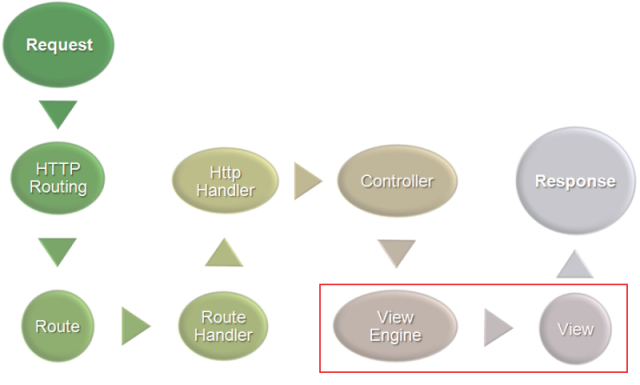
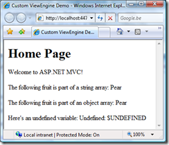

Have you ever seen a presentation of [ScottGu](http://weblogs.asp.net/scottgu/) about the ASP.NET MVC framework? There is one particular slide that keeps coming back, stating that every step in the ASP.NET MVC life cycle is pluggable. Let's find out if replacing one of these components is actually easy by creating a custom _ViewEngine_ and corresponding view.



## Some background

After a route has been determined by the route handler, a _Controller_ is fired up. This _Controller_ sets ViewData, which is afterwards passed into the _ViewEngine_. In short, the _ViewEngine_ processes the view and provides the view with _ViewData_ from the _Controller_. Here's the base class:

```csharp
public abstract class ViewEngineBase {
     public abstract void RenderView(ViewContext viewContext);
}

```

By default, the ASP.NET MVC framework has a _ViewEngine_ named _WebFormsViewEngine_. As the name implies, this _WebFormsViewEngine_ is used to render a view which is created using ASP.NET web forms.

The [MvcContrib](http://www.codeplex.com/MVCContrib) project contains some other ViewEngine implementations like NVelocity, Brail, NHaml, XSLT, ...

## What we are going to build...

[](/images/WindowsLiveWriter/CreatingacustomIViewEngi.NETMVCframework_1265A/image_12.png)In this blog post, we'll build a custom _ViewEngine_ which will render a page like you see on the right from a view with the following syntax:

```csharp
<!DOCTYPE html PUBLIC "-//W3C//DTD XHTML 1.0 Transitional//EN" "http://www.w3.org/TR/xhtml1/DTD/xhtml1-transitional.dtd">
<html xmlns="http://www.w3.org/1999/xhtml" >
<head>
    <title>Custom ViewEngine Demo</title>
</head>
<body>
    <h1>{$ViewData.Title}</h1>
    <p>{$ViewData.Message}</p>
    <p>The following fruit is part of a string array: {$ViewData.FruitStrings[1]}</p>
    <p>The following fruit is part of an object array: {$ViewData.FruitObjects[1].Name}</p>
    <p>Here's an undefined variable: {$UNDEFINED}</p>
</body>
</html>

```

## What do we need?

First of all, download the current [ASP.NET MVC framework from CodePlex](http://www.codeplex.com/aspnet/Release/ProjectReleases.aspx?ReleaseId=12640). After creating a new ASP.NET MVC web site, tweak some stuff:

- Remove /Views/_._
- Remove /Content/_._ (unless you want to keep the default CSS files)
- Add a folder /Code

In order to create a ViewEngine, we will have to do the following:

- Create a default _IControllerFactory_ which sets the _ViewEngine_ we will create on each _Controller_
- Edit Global.asax.cs and register the default controller factory
- Create a _ViewLocator_ (this one will map a controller + action to a specific file name that contains the view to be rendered)
- Create a _ViewEngine_ (the actual purpose of this blog post)

## Let's do some coding!

### 1. Creating and registering the IControllerFactory implementation

Of course, ASP.NET MVC has a default factory which creates a _Controller_ instance for each incoming request. This factory takes care of dependency injection, including _Controller_ initialization and the assignment of a _ViewEngine_. Since this is a good point of entry to plug our own _ViewEngine_ in, we'll create an inherited version of the _DefaultControllerFactory_:

```csharp
public class SimpleControllerFactory : DefaultControllerFactory
{
    protected override IController CreateController(RequestContext requestContext, string controllerName)
    {
        Controller controller = (Controller)base.CreateController(requestContext, controllerName);
        controller.ViewEngine = new SimpleViewEngine(); // <-- will be implemented later in this post
        return controller;
    }
}

```

In order to make this _SimpleControllerFactory_ the default factory, edit the Global.asax.cs file and add the following line of code in the Application_Start event:

```csharp
ControllerBuilder.Current.SetControllerFactory(typeof(SimpleControllerFactory));

```

### 2. Create a ViewLocator

In order for the _ViewEngine_ we'll build to find the correct view for each controller + action combination, we'll have to implement a _ViewLocator_ too:

```csharp
public class SimpleViewLocator : ViewLocator
{
    public SimpleViewLocator()
    {
        base.ViewLocationFormats = new string[] { "~/Views/{1}/{0}.htm",
                                                  "~/Views/{1}/{0}.html",
                                                  "~/Views/Shared/{0}.htm",
                                                  "~/Views/Shared/{0}.html"
        };
        base.MasterLocationFormats = new string[] { "" };
    }
}

```

We are actually providing the possible application paths where a view can be stored.

### 3. Create a ViewEngine

The moment you have been waiting for! The _IViewEngine_ interface requires the following class structure:

```csharp
public class SimpleViewEngine : IViewEngine
{
    // ...
    // Private member: IViewLocator _viewLocator = null;
    // Public property: IViewLocator ViewLocator
    // ...
    #region IViewEngine Members
    public void RenderView(ViewContext viewContext)
    {
        string viewLocation = ViewLocator.GetViewLocation(viewContext, viewContext.ViewName);
        if (string.IsNullOrEmpty(viewLocation))
        {
            throw new InvalidOperationException(string.Format("View {0} could not be found.", viewContext.ViewName));
        }
        string viewPath = viewContext.HttpContext.Request.MapPath(viewLocation);
        string viewTemplate = File.ReadAllText(viewPath);
        IRenderer renderer = new PrintRenderer();
        viewTemplate = renderer.Render(viewTemplate, viewContext);
        viewContext.HttpContext.Response.Write(viewTemplate);
    }
    #endregion
}

```

Note that we first locate the view using the _ViewLocator_, map it to a real path on the server and then render contents directly to the HTTP response. The _PrintRenderer_ class maps {$....} strings in the view to a real variable from _ViewData_. If you want to see the implementation, please check the download of this example.

## Conclusion

 Replacing the default _ViewEngine_ with a custom made version is actually quite easy! The most difficult part in creating your own _ViewEngine_ implementation will probably be the parsing of your view. Fortunately, there are some examples around which may be a good source of inspiration (see [MvcContrib](http://www.codeplex.com/MVCContrib)).

If someone wants to use the code snippets I posted to create their own PHP [Smarty](http://smarty.php.net), please let me know! Smarty is actually quite handy, and might also be useful in ASP.NET MVC.

And yes, it has been a lot of reading, but I did not forget. Download the example code from this blog post: [CustomViewEngine.zip (213.17 kb)](/files/ASPNETMVC_CustomViewEngine.zip)
