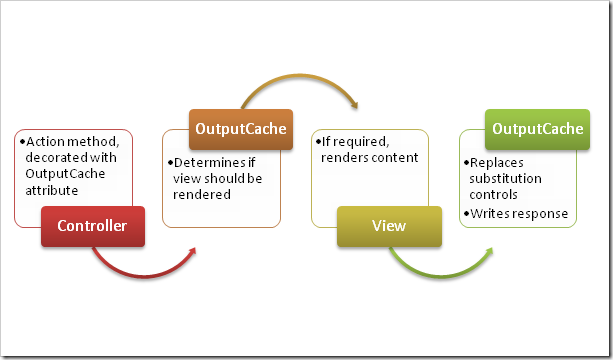

In my [previous blog post on ASP.NET MVC OutputCache](/posts/2008-06-26-creating-an-aspnet-mvc-outputcache-actionfilterattribute/), not all aspects of "classic" ASP.NET output caching were covered. For instance, substitution of cached pages. Allow me to explain...

When using output caching you might want to have everything cached, except, for example, a user's login name or a time stamp. When caching a full HTTP response, it is not really possible to inject dynamic data. ASP.NET introduced the _Substitution_ control, which allows parts of a cached response to be dynamic. The contents of the Substitution control are dynamically injected after retrieving cached data, by calling a certain static method which returns string data. Now let's build this into my _[OutputCache ActionFilterAttribute](/posts/2008-06-26-creating-an-aspnet-mvc-outputcache-actionfilterattribute/)_...

**UPDATE:** Also check Phil Haack's approach to this: [http://haacked.com/archive/2008/11/05/donut-caching-in-asp.net-mvc.aspx](http://haacked.com/archive/2008/11/05/donut-caching-in-asp.net-mvc.aspx)

## 1. But... how?

Schematically, the substitution process would look like this:



When te view is rendered, it outputs a special substitution tag (well, special... just a HTML comment which will be recognized by the OutputCache). The OutputCache will look for these substitution tags and call the relevant methods to provide contents. A substitution tag will look like _<!--SUBSTITUTION:CLASSNAME:METHODNAME-->_.

One side note: this will only work with server-side caching (duh!). Client-side could also be realized, but that would involve some Ajax calls.

## 2. Creating a HtmlHelper extension method

Every developer loves easy-to-use syntax, so instead of writing an error-prone HTML comment like _<!--SUBSTITUTION:CLASSNAME:METHODNAME-->_. myself, let's do that using an extension method which allows syntax like <%=Html.Substitution<MvcCaching.Views.Home.Index>("SubstituteDate")%>. Here's an example view:

```csharp
<%@ Page Language="C#" MasterPageFile="~/Views/Shared/Site.Master"
    AutoEventWireup="true" CodeBehind="Index.aspx.cs"
    Inherits="MvcCaching.Views.Home.Index" %>
<%@ Import Namespace="MaartenBalliauw.Mvc.Extensions" %>
<asp:Content ID="indexContent" ContentPlaceHolderID="MainContent" runat="server">
    <h2><%= Html.Encode(ViewData["Message"]) %></h2>
    <p>
        Cached timestamp: <%=Html.Encode(DateTime.Now.ToString())%>
    </p>
    <p>
        Uncached timestamp (substitution):
        <%=Html.Substitution<MvcCaching.Views.Home.Index>("SubstituteDate")%>
    </p>
</asp:Content>

```

The extension method for this will look quite easy. Create a new static class containing this static method:

```csharp
public static class CacheExtensions
{
    public static string Substitution<T>(this HtmlHelper helper, string method)
    {
        // Check input
        if (typeof(T).GetMethod(method, BindingFlags.Static | BindingFlags.Public) == null)
        {
            throw new ArgumentException(
                string.Format("Type {0} does not implement a static method named {1}.",
                    typeof(T).FullName, method),
                        "method");
        }
        // Write output
        StringBuilder sb = new StringBuilder();
        sb.Append("<!--");
        sb.Append("SUBSTITUTION:");
        sb.Append(typeof(T).FullName);
        sb.Append(":");
        sb.Append(method);
        sb.Append("-->");
        return sb.ToString();
    }
}

```

What happens is basically checking for the existance of the specified class and method, and rendering the appropriate HTML comment. Our example above will output _<!--SUBSTITUTION:MvcCaching.Views.Home.Index:SubstituteDate-->_.

One thing to do before substituting data though: defining the _SubstituteDate_ method on the MvcCaching.Views.Home.Index: view codebehind. The signature of this method should be static, returning a string and accepting a _ControllerContext_ parameter. In developer language: _static string MyMethod(ControllerContext context);_

Here's an example:

```csharp
public partial class Index : ViewPage
{
    public static string SubstituteDate(ControllerContext context)
    {
        return DateTime.Now.ToString();
    }
}

```

## 3. Extending the OutputCache ActionFilterAttribute

[Previously](/posts/2008-06-26-creating-an-aspnet-mvc-outputcache-actionfilterattribute/), we did server-side output caching by implementing 2 overrides of the ActionFilterAttribute, namely _OnResultExecuting_ and _OnResultExecuted_. To provide substitution support, we'll have to modify these 2 overloads a little. Basically, just pass all output through the _ResolveSubstitutions_ method. Here's the updated _OnResultExecuted_ overload:

```csharp
public override void OnResultExecuted(ResultExecutedContext filterContext)
{
    // Server-side caching?
    if (CachePolicy == CachePolicy.Server || CachePolicy == CachePolicy.ClientAndServer)
    {
        if (!cacheHit)
        {
            // Fetch output
            string output = writer.ToString();
            // Restore the old context
            System.Web.HttpContext.Current = existingContext;
            // Fix substitutions
            output = ResolveSubstitutions(filterContext, output);
            // Return rendered data
            existingContext.Response.Write(output);
            // Add data to cache
            cache.Add(
                GenerateKey(filterContext),
                writer.ToString(),
                null,
                DateTime.Now.AddSeconds(Duration),
                Cache.NoSlidingExpiration,
                CacheItemPriority.Normal,
                null);
        }
    }
}

```

Now how about this _ResolveSubstitutions_ method? This method is passed the _ControllerContext_ and the unmodified HTML output. If no substitution tags are found, it returns immediately. Otherwise, a regular expression is fired off which will perform replaces depending on the contents of this substitution variable.

_One thing to note here is that this is actually a nice security hole! Be sure to **ALWAYS** Html.Encode() dynamic data, as users can inject these substitution tags easily in your dynamic pages and possibly receive useful error messages with context information..._

```csharp
private string ResolveSubstitutions(ControllerContext filterContext, string source)
{
    // Any substitutions?
    if (source.IndexOf("<!--SUBSTITUTION:") == -1)
    {
        return source;
    }
    // Setup regular expressions engine
    MatchEvaluator replaceCallback = new MatchEvaluator(
        matchToHandle =>
        {
            // Replacements
            string tag = matchToHandle.Value;
            // Parts
            string[] parts = tag.Split(':');
            string className = parts[1];
            string methodName = parts[2].Replace("-->", "");
            // Execute method
            Type targetType = Type.GetType(className);
            MethodInfo targetMethod = targetType.GetMethod(methodName, BindingFlags.Static | BindingFlags.Public);
            return (string)targetMethod.Invoke(null, new object[] { filterContext });
        }
    );
    Regex templatePattern = new Regex(@"<!--SUBSTITUTION:[A-Za-z_\.]+:[A-Za-z_\.]+-->", RegexOptions.Multiline);
    // Fire up replacement engine!
    return templatePattern.Replace(source, replaceCallback);
}

```

How easy was all that? You can [download the full soure and an example here](http://examples.maartenballiauw.be/AspNetMvcOutputCache/MvcCaching.zip).
