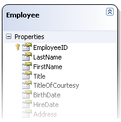
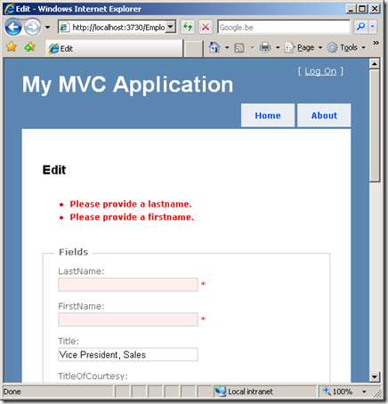

Last week, the [ASP.NET MVC framework release candidate](http://go.microsoft.com/fwlink/?LinkID=141184&clcid=0x409) was released (check [ScottGu’s post](http://weblogs.asp.net/scottgu/archive/2009/01/27/asp-net-mvc-1-0-release-candidate-now-available.aspx)). Apart from some great new tooling support, form validation has never been easier. Here’s a quick introduction.

 Imagine we have a LINQ to SQL data model, containing an _Employee_ from the Northwind database. As you may know, LINQ to SQL will generate this _Employee_ class as a partial class, which we can use to extend this domain object’s behaviour. Let’s extend this class with an interface implementation for _IDataErrorInfo_.

```csharp
public partial class Employee : IDataErrorInfo
{
    #region IDataErrorInfo Members
    public string Error
    {
        get { throw new NotImplementedException(); }
    }
    public string this[string columnName]
    {
        get { throw new NotImplementedException(); }
    }
    #endregion
}

```

_IDataErrorInfo_ is an interface definition that is found in _System.ComponentModel_. It provides the functionality to offer custom error information that a user interface can bind to. Great, let’s do that! Assume we have a view which is used to edit this _Employee_ object. The code for this will be quite easy: some HTML form stuff, _Html.ValidationMessage_ calls, … Here’s a snippet:

```csharp
<asp:Content ID="Content2" ContentPlaceHolderID="MainContent" runat="server">
    <h2>Edit</h2>
    <%= Html.ValidationSummary() %>
    <% using (Html.BeginForm()) {>
        <%= Html.Hidden("id", Model.EmployeeID) %>
        <fieldset>
            <legend>Fields</legend>
            <p>
                <label for="LastName">LastName:</label>
                <%= Html.TextBox("LastName") %>
                <%= Html.ValidationMessage("LastName", "*") %>
            </p>
            <!-- ... -->
        <fieldset>
    <% } %>
</asp:Content>

```

The controller’s action method for this will look like the following:

```csharp
[AcceptVerbs(HttpVerbs.Post)]
public ActionResult Edit(int id, FormCollection collection)
{
    Employee employee = repository.RetrieveById(id);
    try
    {
        UpdateModel(employee, collection.ToValueProvider());
        repository.Save(employee);
        return RedirectToAction("Index");
    }
    catch
    {
        return View(employee);
    }
}

```

Nothing fancy here: a call to _UpdateModel_ (to populate the _Employee_ instance with data fom the form) and a try-catch construction. How will this thing know what’s wrong? This is where the _IDataErrorInfo_ interface comes useful. ASP.NET MVC’s _UpdateModel_ method will look for this interface implementation and retrieve information from it. The _Error_ property that is defined on _IDataErrorInfo_ returns a string containing any error that is “global” for the _Employee_ object. The *this[string columnName] *indexer that is defined on _IDataErrorInfo_ is used to retrieve error messages for a specific property. Now let’s make sure _FirstName_ and _LastName_ are provided:

```csharp
public partial class Employee : IDataErrorInfo
{
    #region IDataErrorInfo Members
    public string Error
    {
        get { return ""; }
    }
    public string this[string columnName]
    {
        get
        {
            switch (columnName.ToUpperInvariant())
            {
                case "FIRSTNAME":
                    if (string.IsNullOrEmpty(FirstName))
                        return "Please provide a firstname.";
                    break;
                case "LASTNAME":
                    if (string.IsNullOrEmpty(LastName))
                        return "Please provide a lastname.";
                    break;
            }
            return "";
        }
    }
    #endregion
}

```

Great, let’s try it out. If I omit the firstname or lastname when editing an Employee object, here’s what the view looks like:



How easy was that! More on the new things in the ASP.NET MVC release candidate can be found in [ScottGu’s blog post](http://weblogs.asp.net/scottgu/archive/2009/01/27/asp-net-mvc-1-0-release-candidate-now-available.aspx).
