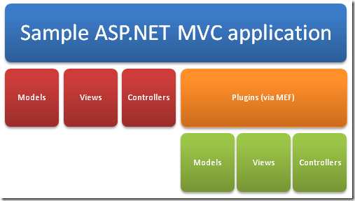
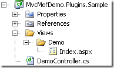
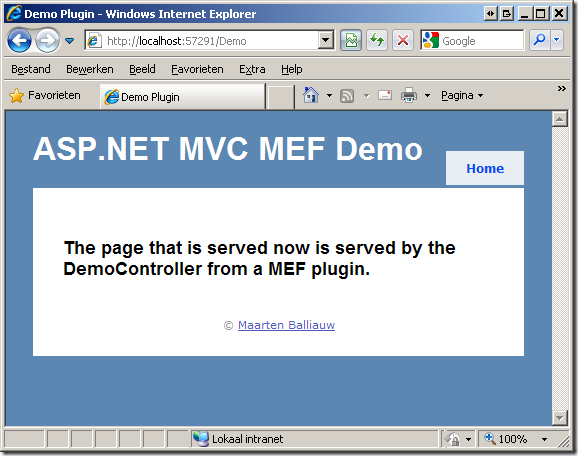

Microsoft’s Managed Extensibility Framework (MEF) is a .NET library (released on [CodePlex](http://mef.codeplex.com/)) that enables greater re-use of application components. You can do this by dynamically composing your application based on a set of classes and methods that can be combined at runtime. Think of it like building an appliation that can host plugins, which in turn can also be composed of different plugins. Since examples say a thousand times more than text, let’s go ahead with a sample leveraging MEF in an ASP.NET MVC web application.

## Getting started…

The Managed Extensibility Framework can be downloaded from the [CodePlex website](http://mef.codeplex.com/). In the download, you’ll find the full source code, binaries and some examples demonstrating different use cases for MEF.

Now here’s what we are going to build: an ASP.NET MVC application consisting of typical components (model, view, controller), containing a folder “Plugins” in which you can dynamically add more models, views and controllers using MEF. Schematically:



## Creating a first plugin

Before we build our host application, let’s first create a plugin. Create a new class library in Visual Studio, add a reference to the MEF assembly (_System.ComponentModel.Composition.dll_) and to _System.Web.Mvc_ and _System.Web.Abstractions_. Next, create the following project structure:



That is right: a _DemoController_ and a _Views_ folder containing a _Demo_ folder containing _Index.aspx_ view. Looks a bit like a regular ASP.NET MVC application, no? Anyway, the _DemoController_ class looks like this:

```csharp
[Export(typeof(IController))]
[ExportMetadata("controllerName", "Demo")]
[PartCreationPolicy(CreationPolicy.NonShared)]
public class DemoController : Controller
{
    public ActionResult Index()
    {
        return View("~/Plugins/Views/Demo/Index.aspx");
    }
}

```

Nothing special, except… what are those three attributes doing there, _Export_ and _PartCreationPolicy_? In short:

- _Export_ tells the MEF framework that our _DemoController_ class implements the _IController_ contract and can be used when the host application is requesting an _IController_ implementation.
- _ExportMetaData_ provides some metadata to the MEF, which can be used to query plugins afterwards.
- _PartCreationPolicy_ tells the MEF framework that it should always create a new instance of DemoController whenever we require this type of controller. By defaukt, a single instance would be shared across the application which is not what we want here. _CreationPolicy.NonShared_ tells MEF to create a new instance every time.

Now we are ready to go to our host application, in which this plugin will be hosted.

## Creating our host application

The ASP.NET MVC application hosting these plugin controllers is a regular ASP.NET MVC application, in which we’ll add a reference to the MEF assembly (_System.ComponentModel.Composition.dll_). Next, edit the _Global.asax.cs_ file and add the following code in _Application_Start_:

```csharp
ControllerBuilder.Current.SetControllerFactory(
    new MefControllerFactory(
        Path.Combine(AppDomain.CurrentDomain.BaseDirectory, "Plugins")));

```

What we are doing here is telling the ASP.NET MVC framework to create controller instances by using the _MefControllerFactory_ instead of ASP.NET MVC’s default _DefaultControllerFactory_. Remember that everyone’s always telling ASP.NET MVC is very extensible, and it is: we are now changing a core component of ASP.NET MVC to use our custom _MefControllerFactory_ class. We’re also telling our own _MefControllerFactory_ class to check the “Plugins” folder in our web application for new plugins. By the way, here’s the code for the _MefControllerFactory_:

```csharp
public class MefControllerFactory : IControllerFactory
{
    private string pluginPath;
    private DirectoryCatalog catalog;
    private CompositionContainer container;
    private DefaultControllerFactory defaultControllerFactory;
    public MefControllerFactory(string pluginPath)
    {
        this.pluginPath = pluginPath;
        this.catalog = new DirectoryCatalog(pluginPath);
        this.container = new CompositionContainer(catalog);
        this.defaultControllerFactory = new DefaultControllerFactory();
    }
    #region IControllerFactory Members
    public IController CreateController(System.Web.Routing.RequestContext requestContext, string controllerName)
    {
        IController controller = null;
        if (controllerName != null)
        {
            string controllerClassName = controllerName + "Controller";
            Export<IController> export = this.container.GetExports<IController>()
                                             .Where(c => c.Metadata.ContainsKey("controllerName")
                                                 && c.Metadata["controllerName"].ToString() == controllerName)
                                             .FirstOrDefault();
            if (export != null) {
                controller = export.GetExportedObject();
            }
        }
        if (controller == null)
        {
            return this.defaultControllerFactory.CreateController(requestContext, controllerName);
        }
        return controller;
    }
    public void ReleaseController(IController controller)
    {
        IDisposable disposable = controller as IDisposable;
        if (disposable != null)
        {
            disposable.Dispose();
        }
    }
    #endregion
}

```

Too much? Time for a breakdown. Let’s start with the constructor:

```csharp
public MefControllerFactory(string pluginPath)
{
    this.pluginPath = pluginPath;
    this.catalog = new DirectoryCatalog(pluginPath);
    this.container = new CompositionContainer(catalog);
    this.defaultControllerFactory = new DefaultControllerFactory();
}

```

In the constructor, we are storing the path where plugins can be found (the “Plugins” folder in our web application). Next, we are telling MEF to create a catalog of plugins based on what it can find in that folder using the _DirectoryCatalog_ class. Afterwards, a _CompositionContainer_ is created which will be responsible for matching plugins in our application.

Next, the _CreateController_ method we need to implement for _IControllerFactory_:

```csharp
public IController CreateController(System.Web.Routing.RequestContext requestContext, string controllerName)
{
    IController controller = null;
    if (controllerName != null)
    {
        string controllerClassName = controllerName + "Controller";
        Export<IController> export = this.container.GetExports<IController>()
                                         .Where(c => c.Metadata.ContainsKey("controllerName")
                                             && c.Metadata["controllerName"].ToString() == controllerName)
                                         .FirstOrDefault();
        if (export != null) {
            controller = export.GetExportedObject();
        }
    }
    if (controller == null)
    {
        return this.defaultControllerFactory.CreateController(requestContext, controllerName);
    }
    return controller;
}

```

This method handles the creation of a controller, based on the current request context and the controller name that is required. What we are doing here is checking MEF’s container for all “Exports” (plugins as you wish) that match the controller name. If one is found, we return that one. If not, we’re falling back to ASP.NET MVC’s _DefaultControllerBuilder_.

The _ReleaseController_ method is not really exciting: it's used by ASP.NET MVC to correctly dispose a controller after use.

## Running the sample

First of all, the sample code can be downloaded here: [MvcMefDemo.zip (270.82 kb)](/files/2009/4/MvcMefDemo.zip)

When launching the application, you’ll notice nothing funny. That is, untill you want to navigate to the [http://localhost:xxxx/Demo](http://localhost:xxxx/Demo) URL: there is no _DemoController_ to handle that request! Now compile the plugin we’ve just created (in the _MvcMefDemo.Plugins.Sample_ project) and copy the contents from the \bin\Debug folder to the \Plugins folder of our host application. Now, when the application restarts (for example by modifying web.config), the plugin will be picked up and the [http://localhost:xxxx/Demo](http://localhost:xxxx/Demo) URL will render the contents from our _DemoController_ plugin:



## Conclusion

The [MEF (Managed Extensibility Framework)](http://mef.codeplex.com/) offers a rich manner to dynamically composing applications. Not only does it allow you to create a plugin based on a class, it also allows exporting methods and even properties as a plugin (see the samples in the CodePlex download).

By the way, sample code can be downloaded here: [MvcMefDemo.zip (270.82 kb)](/files/2009/4/MvcMefDemo.zip)
