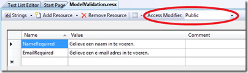
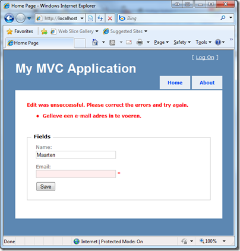

Living in a country where there are there are [three languages being used](http://en.wikipedia.org/wiki/Belgium#Languages), almost every application you work on requires some form of localization. In an earlier blog post, I already mentioned [ASP.NET MVC 2’s DataAnnotations](/posts/2009-07-31-aspnet-mvc-2-preview-1-released/) support for doing model validation. Ever since, I was wondering if it would be possible to use resource files or something to do localization of error messages, since every example that could be found on the Internet looks something like this:

```csharp
[MetadataType(typeof(PersonBuddy))]
public class Person
{
    public string Name { get; set; }
    public string Email { get; set; }
}
public class PersonBuddy
{
    [Required(ErrorMessage = "Name is required.")]
    public string Name { get; set; }
    [Required(ErrorMessage = "E-mail is required.")
    public string Email { get; set; }
}

```

Yes, those are hardcoded error messages. And yes, only in one language. Let’s see how localization of these would work.

## 1. Create a resource file

Add a resource file to your ASP.NET MVC 2 application. Not in _App_GlobalResources_ or _App_LocalResources_, just a resource file in a regular namespace. Next, enter all error messages that should be localized in a key/value manner. Before you leave this file, make sure that the _Access_ _Modifier_ property is set to _Public_.



## 2. Update your “buddy classes”

Update your “buddy classes” (or metadata classes or whatever you call them) to use the _ErrorMessageResourceType_ and _ErrorMessageResourceName_ parameters instead of the _ErrorMessage_ parameter that you normally pass. Here’s the example from above:

```csharp
[MetadataType(typeof(PersonBuddy))]
public class Person
{
    public string Name { get; set; }
    public string Email { get; set; }
}
public class PersonBuddy
{
    [Required(ErrorMessageResourceType = typeof(Resources.ModelValidation), ErrorMessageResourceName = "NameRequired")]
    public string Name { get; set; }
    [Required(ErrorMessageResourceType = typeof(Resources.ModelValidation), ErrorMessageResourceName = "EmailRequired")]
    public string Email { get; set; }
}

```

## 3. See it work!

After creating a resource file and updating the buddy classes, you can go back to work and use model binders, _ValidationMessage_ and _ValidationSummary_. ASP.NET will make sure that the correct language is used based on the thread culture info.


