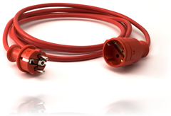

<p> The concept of “extension” methods will be nothing new to this blog’s .NET-related audience. For the PHP-related audience, this is probably something new. Let’s start with the official definition for extension methods: <em>Extension methods enable you to &quot;add&quot; methods to existing types without creating a new derived type, recompiling, or otherwise modifying the original type. Extension methods are a special kind of static method, but they are called as if they were instance methods on the extended type.</em></p>  <p>Let’s visualize this. Imagine having the following class:</p>

```php
class HelloWorld
{
    public function sayHello($to = 'World', $from = null)
    {
        $helloString = "Hello, " . $to . "!";
        if (!is_null($from)) {
            $helloString .= " From " . $from;
        }

        echo $helloString . "\r\n";
    }
}
```

  <p>Not too difficult. There’s a s<em>ayHello() </em>method that allows you to optionally pass who should be greeted and who the greeting is from. Imagine you would like to have a <em>sayHelloTo()</em> method as well, a shortcut to <em>sayHello($to)</em>. And some other helper methods that use s<em>ayHello() </em>under the hood. Wouldn’t it be nice to have the <em>HelloWorld</em> class concentrating on the real logic and defining the helper/utility functions somewhere else? How about a class named <em>HelloExtensions</em>:</p>

```php
class HelloWorldExtensions
{
    public static function sayHelloTo(HelloWorld $subject, $name = '')
    {
        $subject->sayHello($name);
    }

    public static function sayHelloFrom(HelloWorld $subject, $name = '')
    {
        $subject->sayHello('World', $name);
    }
}
```

  <p>Ok, nice. But this means I should call <em>HelloWorldExtensions::sayHelloTo(‘Maarten’);</em> to use the utility functions, right? Well: no! Not if we implement the concept of extension methods. Let’s see what we can do to <em>HelloWorld</em> in order to make our life easier.</p>

```php
class HelloWorld
{
    public function sayHello($to = 'World', $from = null)
    {
        $helloString = "Hello, " . $to . "!";
        if (!is_null($from)) {
            $helloString .= " From " . $from;
        }

        echo $helloString . "\r\n";
    }

    public function __call($functionName, $arguments = array())
    {
        // Add an extra parameter
        array_unshift($arguments, $this);

        // Current reflected class
        $reflectedClass = new reflectionObject($this);

        // Find suitable class and function
        $availableClasses = get_declared_classes();
        foreach ($availableClasses as $class) {
            $classDefinition = new ReflectionClass($class);
            $availableMethods = $classDefinition->getMethods();
            foreach ($availableMethods as $method) {
                if ($method->isStatic() && $method->getName() == $functionName) {
                    $availableParameters = $method->getParameters();
                    if ($availableParameters[0]->getClass()->getName() == $reflectedClass->getName()) {
                        $method->invokeArgs(null, $arguments);
                    }
                }
            }
        }
    }
}
```

  <p>The magic method <em>__call()</em> is used to look for a class that defines a static method with the first parameter of our type, <em>HelloWorld</em>. This now allows us to write very clean calls to code, as well as simplify our <em>HelloWorld </em>class:</p>

```php
$helloWorld = new HelloWorld();
$helloWorld->sayHello();
$helloWorld->sayHelloTo('Maarten');
$helloWorld->sayHelloFrom('Maarten');
```

  <p>Sweet, no? Can someone get this into the PHP core? I would greatly appreciate it: my classes can focus on functionality and all utility functions that just pass around variables can be defined in a separate class.</p>
