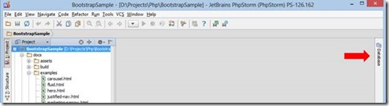
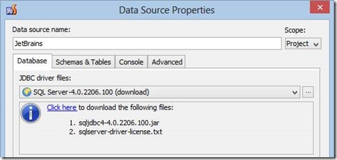
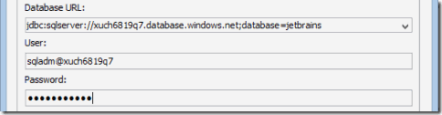
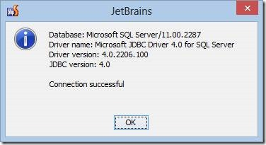
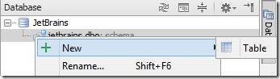
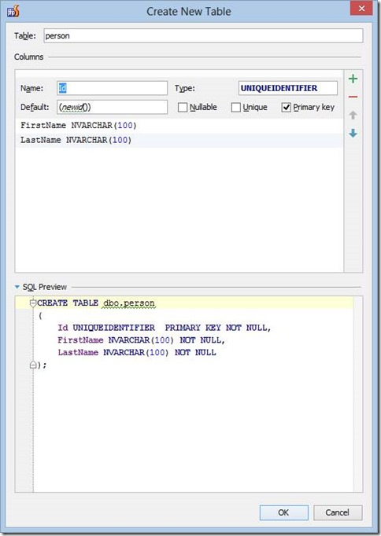
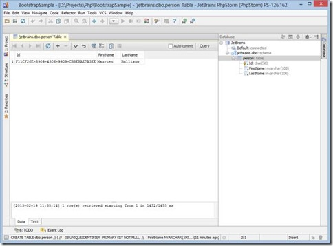
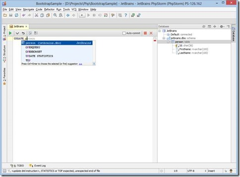
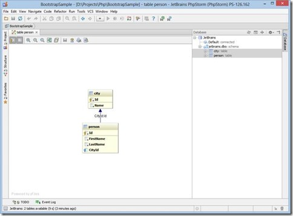
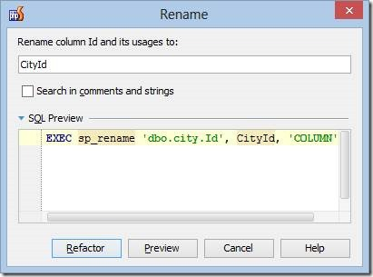

_Disclaimer: My job at *[*JetBrains*](http://www.jetbrains.com)* holds a lot of “exploration of tools”. From time to time I discover things I personally find really cool and blog about those on the JetBrains blogs. If it relates to Windows Azure, I typically cross-post on my personal blog._

[](/images/clip_image002_4.jpg)PhpStorm provides us the possibility to connect to Windows Azure SQL Database right from within the IDE. In this post, we’ll explore several options that are available for working with Windows Azure SQL Database (or database systems like SQL Server, MySQL, PostgreSQL or Oracle, for that matter):

- Setting up a database connection
- Creating a table
- Inserting and updating data
- Using the database console
- Generating a database diagram
- Database refactoring

If you are familiar with Windows Azure SQL Database, make sure to [configure the database firewall](http://msdn.microsoft.com/en-us/library/windowsazure/ee621783.aspx) correctly so you can connect to it from your current machine.

#### <a name="h.ncogzmk7ux8c"></a>Setting up a database connection

Database support can be found on the right-hand side of the IDE or by using the _**Ctrl+Alt+A (Cmd+Alt+A on Mac)**_* *and searching for “Database”.

[](/images/clip_image004_2.jpg)

Opening the database pane, we can create a new connection or _Data Source_. We’ll have to specify the JDBC database driver to be used to connect to our database. Since Windows Azure SQL Database is just “SQL Server” in essence, we can use the *SQL Server *driver available in the list of drivers. PhpStorm doesn’t ship these drivers but a simple click (on “Click here”) fetches the correct JDBC driver from the Internet.

[](/images/clip_image006_2.jpg)

Next, we’ll have to enter our connection details. As the JDBC driver class, select the _com.microsoft.sqlserver.jdbc_ driver. The Database URL should be a connection string to our SQL Database and typically comes in the following form:

```

jdbc:sqlserver://<servername>.database.windows.net;database=<databasename>

```

The username to use comes in a different form. Due to a protocol change that was required for Windows Azure SQL Database, we have to suffix the username with the server name.

[](/images/clip_image007.gif)

After filling out the necessary information, we can use the _Test Connection_ button to test the database connection.

[](/images/clip_image009.jpg)

Congratulations! Our database connection is a fact and we can store it by closing the Data Source dialog using the _Ok_ button.

#### <a name="h.3apfo6u5f13u"></a>Creating a table

If we right click a schema discovered in our Data Source, we can use the _**New | Table**_ menu item to create a table.

[](/images/clip_image011.jpg)

We can use the Create New Table dialog to define columns on our to-be-created table. PhpStorm provides us with a user interface which allows us to graphically specify columns and generates the DDL for us.

[](/images/clip_image013.jpg)

Clicking _Ok_ will close the dialog and create the table for us. We can now right-click our table and modify existing columns or add additional columns and generate DDL which alters the table.

#### <a name="h.qguqoz1mxdaf"></a>Inserting and updating data

After creating a table, we can insert data (or update data from an existing table). Upon connecting to the database, PhpStorm will display a list of all tables and their columns. We can select a table and press _**F4**_ (or right-click and use the _Table Editor_ context menu).

[](/images/clip_image015.jpg)

We can add new rows and/or edit existing rows by using the ***+ ***and _**-**_ buttons in the toolbar. By default, auto-commit is enabled and changes are committed automatically to the database. We can disable this option and manually commit and rollback any changes that have been made in the table editor.

#### <a name="h.ljaqg6wifjae"></a>Using the database console

Sometimes there is no better tool than a database console. We can bring up the Console by right-clicking a table and selecting the _**Console**_ menu item or simply by pressing _**Ctrl+Shift+F10 (Cmd+Shift+F10 on Mac)**_.

[](/images/clip_image017.jpg)

We can enter any SQL statement in the console and run it against our database. As you can see from the screenshot above, we even get autocompletion on table names and column names!

#### <a name="h.6f86lf4sf5jz"></a>Generating a database diagram

If we have multiple tables with foreign keys between them, we can easily generate a database diagram by selecting the tables to be included in the diagram and selecting _**Diagrams | Show Visualization...**_ from the context menu or using the _**Ctrl+Alt+Shift+U (Cmd+Alt+Shift+U on Mac)**_. PhpStorm will then generate a database diagram for these tables, displaying how they relate to each other.

[](/images/clip_image019.jpg)

#### <a name="h.lfob9gdcz8mu"></a>Database refactoring

Renaming a table or column often is tedious. PhpStorm includes a Rename refactoring (_**Shift-F6**_) which generates the required SQL code for renaming tables or columns.

[](/images/clip_image021.jpg)

As we’ve seen in this post, working with Windows Azure SQL Database is pretty simple from within PhpStorm using the built-in database support.
