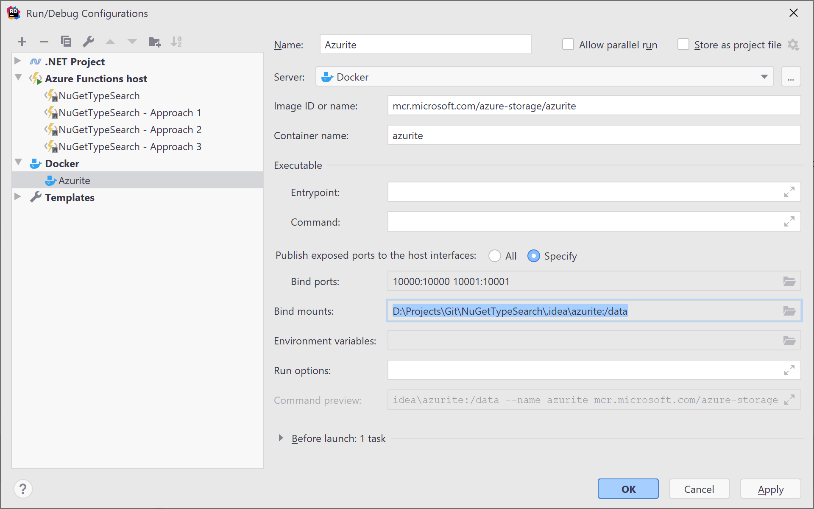
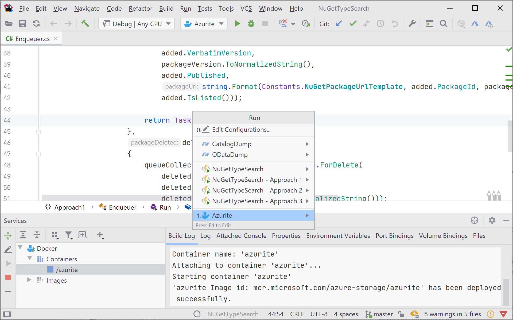

To run the Azurite storage emulator in Docker, start the `mcr.microsoft.com/azure-storage/azurite` image with ports `10000`, `10001` and `10002` published, and mount a folder on your machine to `/data` so blobs, queues and tables survive restarts. Point your app at it with `UseDevelopmentStorage=true`.

In this blog post, we'll see how we can use [Azurite](https://github.com/Azure/Azurite), an open source Azure Storage API compatible server (emulator), in Docker, and how to run it from [JetBrains Rider](https://jetbrains.com/rider/). We can use Azurite in Docker to keep Azure Storage data local to a solution, and, for example, have different blobs and queues for different Azure Functions projects.

## Why use Azurite over Azure Storage Emulator?

Ever since I started playing with Azure back in 2008, I've been using the [Azure Storage Emulator](https://learn.microsoft.com/en-us/azure/storage/common/storage-use-emulator) to have a local storage emulator to develop with. It provides a local environment for testing applications that use Azure blob and/or queues.

I felt it was time to retire the Azure Storage Emulator in favor of its successor: [Azurite](https://github.com/Azure/Azurite). Microsoft has since marked the old emulator as deprecated, and its docs say Azurite supersedes it. There are various reasons for this:

- Azurite supports newer storage API's, and keeps being updated for the latest ones.
- It runs on Windows, Linux and macOS, where the old emulator was Windows-only.
- It can run as a Docker container.
- By setting its volume path to something relative to the solution we're working on, we can keep blobs and queues around. Different solution? Different path! The blobs and queues related to that solution in Azurite.

## Setting up Azurite

We can run Azurite using Docker, by running the following command:

```
docker run -p 10000:10000 -p 10001:10001 -p 10002:10002 mcr.microsoft.com/azure-storage/azurite
```

This will fetch and run the [`mcr.microsoft.com/azure-storage/azurite`](https://hub.docker.com/_/microsoft-azure-storage-azurite) image, exposing ports `10000` (blob), `10001` (queue) and `10002` (table). Back in 2020 only blob and queue were around, table support has been added since and is still marked as preview in the [Azurite docs](https://learn.microsoft.com/en-us/azure/storage/common/storage-use-azurite).

Inside the Docker container, Azurite uses the `/data` folder to store blobs and queue messages. This means that we can map `/data` to a folder on our host machine. When working on different projects and solution, this is great! For every solution, we can map a different path, and preserve the blobs and queues related to that solution in Azurite.

To keep the data, add a volume mapping to `/data`:

```
docker run -p 10000:10000 -p 10001:10001 -p 10002:10002 \
    -v ./.azurite:/data mcr.microsoft.com/azure-storage/azurite
```

## Run Azurite with Docker Compose

If you'd rather check a file into the solution than click together a run configuration, the same setup fits in a `docker-compose.yml`:

```yaml
services:
  azurite:
    image: mcr.microsoft.com/azure-storage/azurite
    container_name: azurite
    ports:
      - "10000:10000"
      - "10001:10001"
      - "10002:10002"
    volumes:
      - ./.azurite:/data
```

Start it with `docker compose up -d`. Don't forget to add `.azurite` to `.gitignore`.

## Connecting to Azurite from your application

Azurite uses a well-known development account, `devstoreaccount1`. The easiest way to connect is the shortcut connection string `UseDevelopmentStorage=true`, which the docs describe as equivalent to the full connection string with the default endpoints on `127.0.0.1` and ports `10000`, `10001` and `10002`:

```csharp
var container = new BlobContainerClient("UseDevelopmentStorage=true", "sample-container");
await container.CreateIfNotExistsAsync();
```

For Azure Functions, `UseDevelopmentStorage=true` is also what you'd put in `AzureWebJobsStorage` in `local.settings.json`.

## Setting up an Azurite run configuration in Rider

In Rider, we can create a new Run Configuration (**Run \| Edit Configurations**), of the type _Docker Image_, and enter the image ID as `mcr.microsoft.com/azure-storage/azurite`. Optionally, we can name the container (I picked `azurite` here).

We'll also have to specify the port bindings (port `10000` and `10001`).

Since we want to preserve the Azurite data locally with our solution, we can create a bind mount as well. In the below screenshot, you can see I mapped `D:\Projects\Git\NuGetTypeSearch\.idea\azurite` to `/data` in the container.



_Note: The `D:\Projects\Git\NuGetTypeSearch\.idea\azurite` path was added into `.gitignore` to make sure blobs/queue messages are not committed to Git._

Once this run configuration is created, we can select and run it. This can be done from the toolbar, but I personally prefer using the <kbd>Ctrl+Alt+Shift+R</kbd> keyboard shortcut, where it's possible to immediately select the run configuration to execute (<kbd>Enter</kbd>) or debug (<kbd>Shift</kbd>, then <kbd>Enter</kbd>).



Once running, we can see the Azurite container's output from the **Services** tool window, but usually we will not need that one.

Want to start running an Azure Functions host next? We can use the respective run configuration for that. And when we switch to another solution, we can stop the current container and start it anew in the other solution, with its own data.

Enjoy!
