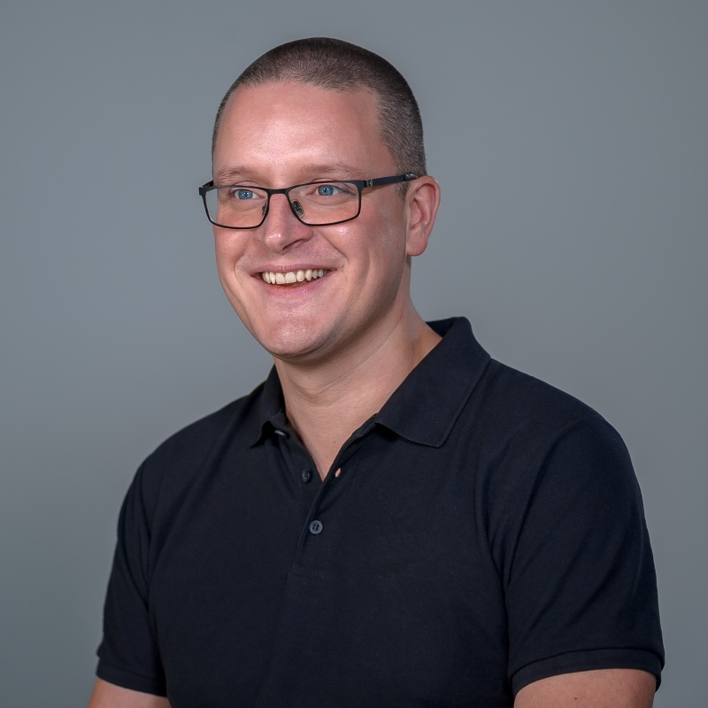

**Hi, I'm Maarten.** I build things for the web with .NET, and I've spent most of the past 20 years helping other developers build theirs. These days I lead Customer Success at [Duende Software](https://duendesoftware.com), the folks behind [Duende IdentityServer](https://duendesoftware.com/products/identityserver). Before that I spent many years at [JetBrains](https://www.jetbrains.com), and before *that* I founded [MyGet](https://www.myget.org).

I'm based in [Antwerp, Belgium](https://en.wikipedia.org/wiki/Antwerp), and if you've been to a .NET conference in the past decade or so, there's a decent chance I was the one with the Belgian accent on stage (or at the booth, or at the bar afterwards).

- 📍 Antwerp, Belgium
- 🎤 250+ conference talks in 25+ countries
- 📝 Blogging here since 2006
- 📦 Founded MyGet and SpeakerTravel
- 📖 Co-author of [Pro NuGet](https://bit.ly/ProNuGetSE) (Apress)
- 🍺 Brews his own beer

## What I do

### Head of Customer Success at Duende Software

*2025 - now*

I lead the Customer Success team at Duende, which covers developer advocacy, onboarding, support and sales engineering. The goal is simple to explain and harder to do: help new and existing customers fall into the pit of success with IdentityServer and the BFF Security Framework. I'm part of the leadership team, but it's very much a hands-on job, and I like it that way.

On a given week, that can mean any of these:

- **Deep technical support.** Code-level help for senior developers and architects building secure .NET apps: debugging an integration, sketching out an identity architecture, or figuring out why that one token has the wrong claims.
- **Docs.** My team owns [docs.duendesoftware.com](https://docs.duendesoftware.com), and I'm one of the most active contributors there (well over a thousand commits since 2025). When the same question shows up in support three times, it should become a docs page.
- **Writing and speaking.** I've written 35+ posts on the [Duende blog](https://duendesoftware.com/blog) about passkeys, BFF, SAML, token exchange, MCP authorization and more, and I talk about passkeys and ASP.NET Core security at NDC, .NET Conf, Techorama, ConFoo and others.
- **Samples, demo and tools.** The [official samples](https://github.com/DuendeSoftware/samples), the [demo IdentityServer](https://demo.duendesoftware.com), and the [Duende AI agent skills](https://github.com/DuendeSoftware/duende-skills) so your coding assistant gives you correct IdentityServer advice instead of something it made up.
- **The website.** Bits of [duendesoftware.com](https://duendesoftware.com), like the License Planner and the IdentityServer Architecture Planner.
- **Connecting the dots.** Taking what customers run into back to the product and engineering teams, and being the technical person on sales calls.

### Head of Developer Advocacy at JetBrains

*Previously*

At JetBrains I started out doing developer advocacy for PhpStorm, then .NET tools (ReSharper, Rider, dotMemory, dotTrace), and eventually led the developer advocacy team. I also helped launch JetBrains Space, starting from the product launch on stage at KotlinConf 2019.

Some things I'm still happy about:

- Writing most of the [Space SDK for .NET](https://github.com/JetBrains/space-dotnet-sdk) (700+ commits), a client generated from a pretty large API, and helping with the Kotlin one.
- Contributing to [Azure Toolkit for Rider](https://github.com/JetBrains/azure-tools-for-intellij) and the [JetBrains Guide](https://www.jetbrains.com/guide/).
- Speaking at a *lot* of events, from NDC and ConFoo to JetBrains Days and Nights in Seoul, Tokyo, Sydney, Melbourne, Paris and Istanbul.
- Blog posts, webinars and videos, and bringing feedback from developers back to the product teams.

### Founder of MyGet and SpeakerTravel

I founded [MyGet](https://www.myget.org), a hosted NuGet and npm package service, and ran it for years on Azure (I gave a few talks about the ups and downs of bootstrapping a SaaS, if you're curious). I also built [SpeakerTravel](https://www.speaker.travel), which helps conference organizers book travel for their speakers without a mountain of spreadsheets and emails.

## Community

- Founding board member of [AZUG](https://www.azug.be), the Belgian Azure user group, and organizer of [CloudBrew](https://www.cloudbrew.be) from 2013 to 2024.
- Track owner at [Techorama](https://techorama.be) for cloud sessions.
- ASP Insider, and a former Microsoft MVP.
- Frequent speaker, see the [full list of talks](/talks-presentations).

## Things I like to talk about

.NET and C#, ASP.NET Core, identity (OAuth, OpenID Connect, passkeys), Azure, application performance, NuGet, HTMX, developer tooling, and the occasional nerd snipe that ends with me streaming audio to a Sonos speaker.

## The beer part

In my free time, I brew my own beer. When I'm not drinking my own, it's probably a [Troubadour Magma](https://themusketeers.be/en/our-beers/troubadour-series-en/troubadour-magma), [Westmalle Tripel](https://www.trappistwestmalle.be/en/page/tripel.aspx), a [Rochefort 10](https://en.wikipedia.org/wiki/Brasserie_de_Rochefort) or a [La Chouffe](https://en.wikipedia.org/wiki/Brasserie_d%27Achouffe). Belgian, obviously.

## Say hi

Have a question, want me to speak at your conference or user group, or just want to chat about .NET? Reach out, I'll try to get back to you as soon as I can.

- **Bluesky:** [@maartenballiauw.be](https://bsky.app/profile/maartenballiauw.be)
- **Mastodon:** [@maartenballiauw@mastodon.online](https://mastodon.online/@maartenballiauw)
- **GitHub:** [maartenba](https://github.com/maartenba)
- **LinkedIn:** [maartenballiauw](https://www.linkedin.com/in/maartenballiauw)
- **X:** [@maartenballiauw](https://x.com/maartenballiauw)

## Bio (for conference organizers)

Feel free to copy this one:

> Maarten Balliauw loves building web and cloud apps. His main interests are in .NET web technologies, C#, identity and application performance. He is Head of Customer Success at Duende Software, and previously led developer advocacy at JetBrains. He founded MyGet and SpeakerTravel, is an ASP Insider and former Microsoft MVP, and co-authored Pro NuGet. Maarten is a frequent speaker at national and international events and organizes Azure User Group events in Belgium. In his free time, he brews his own beer.
